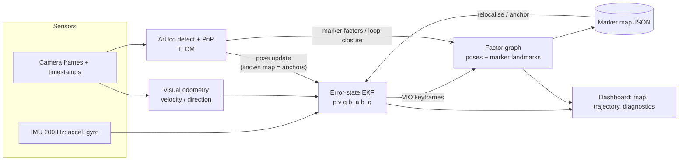

# VISLAM-ArUco — Visual–Inertial Localisation & Mapping with Fiducial Landmark Anchors

IE415 *Control of Autonomous Systems* course project. A handheld camera + IMU is carried through a room
with ArUco markers. The system estimates the person's trajectory, builds a persistent marker map, and uses
**repeated marker sightings for drift correction, loop closure and relocalisation** — while still tracking
when no marker is visible.

**Real-life application — low-cost indoor positioning where GPS fails.** Printed paper markers (a few rupees each) turn a
warehouse, hospital corridor, museum or lab into a positioned space: staff/AR-guide localisation, asset
tracking, robot relocalisation after a power cycle (the "kidnapped robot" problem), and inspection-route logging.



## Quick start (no hardware needed)
```bash
pip install -r requirements.txt
python -m pytest -q                                      # 26 tests
python experiments/run_experiments.py --seeds 5          # the 5 required experiments -> results/
python scripts/run_pipeline.py --dataset data/sim_closed_loop --out results/demo
streamlit run app/dashboard.py                           # interactive UI (incl. the Replay tab)
python scripts/make_replay.py --simulate E2 --out docs/replay_E2.mp4 --html docs/replay_E2.html   # animated replay
```

## What is implemented (and by whom)
| Component | File | Status |
|---|---|---|
| Frames, SE(3)/SO(3) maths | `vislam/geometry.py` | written by us |
| Camera calibration + cam–IMU time-offset estimation | `vislam/calibration.py` | OpenCV calibrateCamera (reused) + our cross-correlation offset estimator |
| ArUco detection + PnP pose | `vislam/aruco.py` | OpenCV detector (reused); pose, reprojection gating written by us |
| Monocular VO (direction) | `vislam/vo.py` | KLT + essential matrix (OpenCV); **only geometry-tested, tune on real footage** |
| **Error-state EKF** (IMU, marker pose, VO updates, χ² gating) | `vislam/ekf.py` | **implemented from scratch** |
| **Landmark graph-SLAM back-end** (sparse, robust) | `vislam/graph.py` | **implemented from scratch** on SciPy least-squares |
| Replay pipeline, relocalisation | `vislam/pipeline.py` | written by us |
| Metrics, diagnostics, plots | `vislam/metrics.py`, `diagnostics.py`, `viz.py` | written by us |
| Simulator (same format as real data + ground truth) | `vislam/sim.py` | written by us |
| Dashboard | `app/dashboard.py` | Streamlit + Plotly |
| Animated replay (dashboard tab, MP4, HTML) | `vislam/replay.py`, `scripts/make_replay.py` | written by us |

No SLAM library is used as a black box. Markers are *inside* the estimator (EKF update + graph factors), not drawn on top of a finished trajectory.

## Results (simulation, 5 seeds, mean ± std — full tables in `results/RESULTS.md`)
| Experiment | IMU only | VIO | VIO + anchors (EKF) | VIO + landmarks (graph SLAM) |
|---|---|---|---|---|
| E1 simple L path — ATE [m] | 1.88 ± 0.87 | 0.123 ± 0.068 | **0.041 ± 0.014** | 0.097 ± 0.031 |
| E2 12 s marker loss — ATE [m] | 25.0 ± 12.5 | 0.135 ± 0.019 | **0.060 ± 0.019** | 0.119 ± 0.015 |
| E3 closed loop — ATE [m] | 25.0 ± 12.5 | 0.118 ± 0.016 | **0.038 ± 0.008** | 0.072 ± 0.023 |
| E3 closed loop — loop residual [m] | 54.9 | 0.165 | **0.040** | 0.074 |
| E5 difficult — ATE [m] | 12.4 ± 7.4 | 0.148 ± 0.025 | **0.094 ± 0.024** | 0.141 ± 0.021 |

E4 relocalisation in a saved map: ATE **0.092 m**, relocalised 3.0 s after the first marker became visible,
versus 1.57 m for VIO started from a wrong assumed pose.

**Honest findings** (these are the "why it works / where it fails" the rubric rewards):
1. Surveyed markers (*anchors*) bound the error; unknown markers (*landmarks*) cannot remove drift they inherited from the trajectory that created them. Graph SLAM beats VIO **only when a loop closes** (E3: 0.118 → 0.072 m); in E1/E2/E5 it is ≈ VIO.
2. During the 12 s blackout, error grows at the VIO drift rate (~1 %/m) and snaps back when a marker reappears. IMU-only diverges in seconds (bias → quadratic error).
3. χ² gating is essential: with a wrong initial pose the EKF rejects every marker (E4 "wrong init" row) — relocalisation must *reset* the pose, not filter it.
4. Graph SLAM orientation can be *worse* than VIO (E1, E5): PnP rotation noise at oblique angles is not modelled well. Future work: ambiguity-aware covariance, IPPE two-solution handling.
5. Sparse, noisy, fast conditions (E5, only 16 % of frames see a marker) erase most of the benefit of landmarks.

> **Scope of these numbers:** they are from the simulator (`vislam/sim.py`), whose noise levels are our assumptions.
> They validate the *algorithms*; your report must also include the same five experiments on **real** data.

## Using the dashboard (`streamlit run app/dashboard.py`)
Light theme (set in `.streamlit/config.toml`). One guided page:
1. **Design your path** — pick a preset, press **🎲 Generate a random path** (optionally looping back to the start), or edit the
   waypoint table (add/delete rows; the preview map shows the smoothed path the simulated person will walk, with the wall markers).
2. **Set the conditions** — walking speed, sensor difficulty (Easy / Normal / Hard), noise seed, and an optional marker blackout.
3. **▶ Simulate & analyse** — runs IMU-only, VIO, VIO + anchors (EKF) and VIO + landmarks (graph SLAM) and shows result cards,
   a plain-language summary, and tabs: **Replay**, **Error analysis** (does losing the markers hurt?), **Map**, **Metrics**, **Markers & sensors**.

The sidebar can instead load a saved dataset or record from a webcam; the same results page is used.
Path logic lives in `vislam/paths.py`, the written findings in `vislam/report.py`.

## Animated replay
A time-synchronised replay of any processed run, as an interactive dashboard tab (**Replay**: ▶ play / ⏸ pause, time slider,
speed, trail length), as a standalone HTML file, and as an exported MP4 (`docs/replay_E2.mp4` is the E2 marker-loss run).

| Element | Meaning |
|---|---|
| black dot + black trail | true position (ground truth) |
| coloured dots + fading trails | each method's estimate (same colours as every other figure); the short coloured tick is its estimated heading |
| grey wedge + black arrow | the camera's true view direction and field of view |
| green dotted lines, marker turns green | markers detected in the current frame (line from the true camera position to the marker) |
| error panel | position error vs. time (log scale) drawn up to "now" with a cursor and live numbers per method |
| red band / red badge | no marker visible (a stretch of ≥ `--min-gap` s, default 1 s, without any detection) |

```bash
python scripts/make_replay.py --dataset data/sim_closed_loop --out results/replay.mp4
python scripts/make_replay.py --simulate E2 --html results/replay_E2.html --speed 2     # E1 / E2 / E3 presets
python scripts/make_replay.py --dataset data/room_run1 --methods VIO "VIO + landmarks (graph SLAM)" --map results/map_saved.json
```
Without ground truth (real recordings) the estimates, marker sightings and no-marker bands are still animated; the error panel is
replaced by a note. Marker positions come from the surveyed map in the dataset, else from the graph-SLAM map. MP4 export uses
`imageio-ffmpeg` (bundled ffmpeg); if it is missing the script writes a GIF instead.

## Using real data (phone + laptop, Architecture C/E)
1. `python scripts/generate_markers.py --ids 0-7 --size-mm 180` → print at 100 %, measure the black square, fix to walls (log positions in `docs/DATA_COLLECTION.md`).
2. Calibrate: 20 checkerboard photos → `python scripts/calibrate_camera.py "calibration/img/*.jpg"`. Target RMS < 0.5 px.
3. Record video + IMU with a phone logger (e.g. *Sensor Logger*, *phyphox*) or `scripts/record_webcam.py` + external IMU. Start with a 3 s vigorous shake for the time-offset estimate.
4. `python scripts/make_dataset.py --video … --imu … --calib calibration/camera.json --marker-size 0.18 --out data/room_run1 [--gt gt.csv --map-gt map_gt.json]`
5. `python scripts/run_pipeline.py --dataset data/room_run1 --out results/room_run1 [--map map.json --reloc]`
6. Inspect everything in `streamlit run app/dashboard.py`.

Check the IMU axis convention (x forward, y left, z up in the body frame) and the `--R-BC` camera mounting; wrong axes are the #1 cause of divergence. The dashboard's `|accel| ≈ 9.81` indicator catches unit errors.

## Repository layout
```
vislam/        core library (geometry, ekf, graph, pipeline, aruco, calibration, vo, metrics, sim, replay)
scripts/       CLI: generate_markers, calibrate_camera, record_webcam, make_dataset, run_pipeline, simulate_dataset, make_replay
experiments/   run_experiments.py  (E1–E5, multi-seed)
app/           dashboard.py (Streamlit)
data/          sim_closed_loop/ (representative dataset with metadata); put real runs here
results/       figures, metrics.json, RESULTS.md, saved marker map
docs/          SYSTEM_DESIGN.md, DATA_COLLECTION.md, MID_EVAL_STATUS.md
tests/         26 unit + integration tests
```
See `docs/SYSTEM_DESIGN.md` for the maths and `docs/MID_EVAL_STATUS.md` for milestone evidence.
